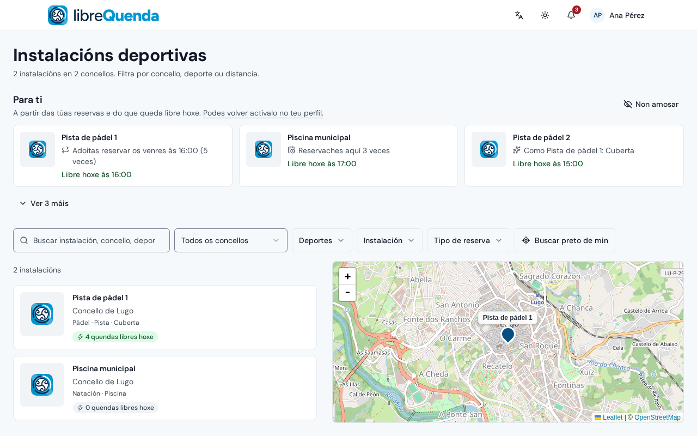
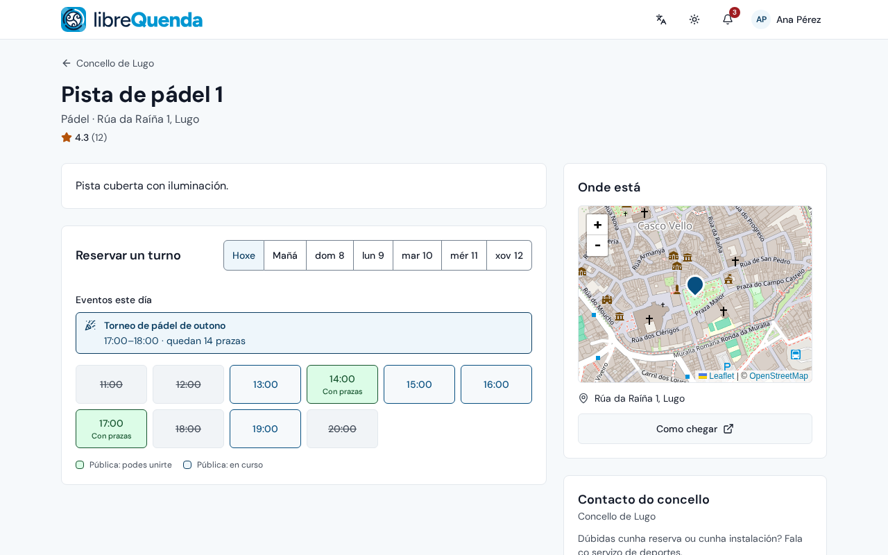
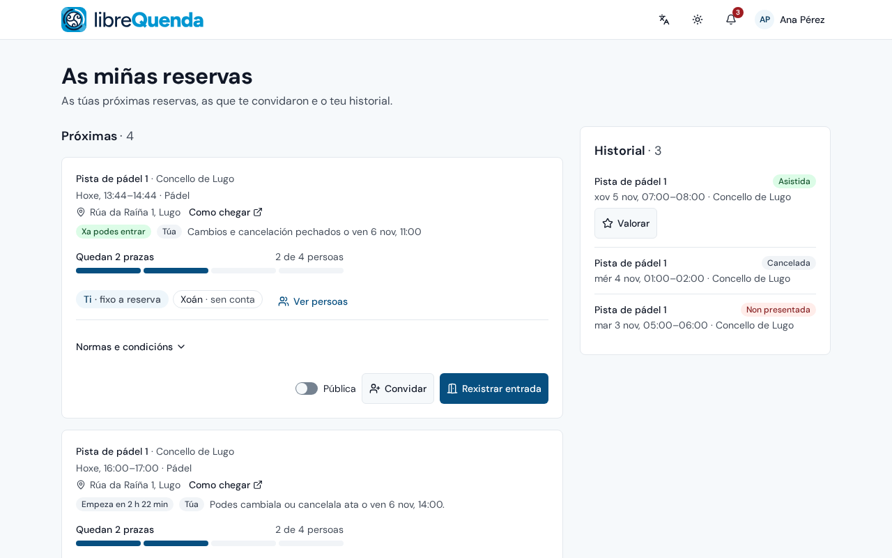
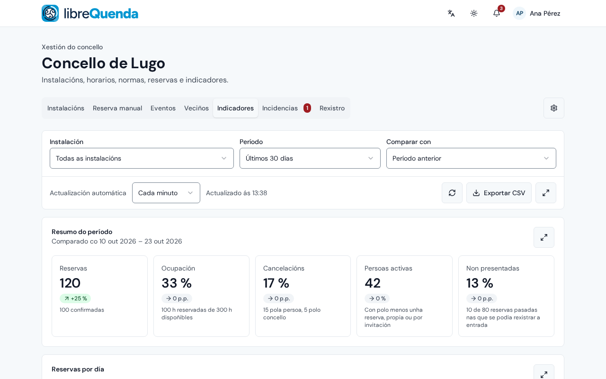

# LibreQuenda

Plataforma de software libre para xestionar e reservar **instalacións deportivas municipais**, feita para os concellos galegos.

A veciñanza consulta as instalacións, reserva, cambia ou cancela as súas reservas, convida outras persoas ou abre unha reserva a quen estea preto, rexistra a entrada na porta (QR, QR impreso, código de entrada ou persoal), avisa de problemas e recibe avisos e correos. Os concellos xestionan as súas instalacións, os horarios, os peches, as normas de uso e as imaxes, responden ás incidencias da veciñanza e seguen indicadores en directo que poden exportar. A superadministración xestiona os concellos e as súas persoas administradoras, e un rexistro de actividade garda cada cambio administrativo. Unha mesma instalación de LibreQuenda pode servir a un concello ou a moitos, na web e nunha app Android que cada instalación pode compilar co seu propio nome e logotipo.

LibreQuenda é a proposta de Tribo Solutions para o [I Certame GOBTEC de Software Libre](https://www.agasol.gal/i-certame-gobtec/) (AGASOL, 2026).

## Capturas

| | |
|---|---|
|  |  |
| **Atopa unha instalación**: as de todos os concellos, nunha lista e nun mapa, e suxestións a partir das túas propias reservas | **Reserva unha quenda**: quendas libres por día, eventos e reservas públicas ás que unirse |
|  |  |
| **As túas reservas**: quen vén, convida ou ábrea a outras persoas, rexistra a entrada na porta | **Xestiona o concello**: instalacións, reservas manuais, eventos, veciñanza, indicadores en directo |

As capturas amosan datos de demostración.

## Requisitos

- Un servidor Linux con [Docker](https://docs.docker.com/engine/install/) (Compose v2), `curl` e `whiptail` (xa vén en Debian e Ubuntu), con 2 GB de RAM (toda a pila usa uns 400 MB en repouso) e algo de disco para a base de datos, as imaxes e as copias de seguridade.
- Dous nomes de dominio que apunten (DNS A/AAAA) a el: a aplicación web e o inicio de sesión, p. ex. `reservas.concello.gal` e `auth.reservas.concello.gal`.
- Os portos 80 e 443 abertos (os certificados HTTPS veñen de Let's Encrypt), ou un servidor web diante que xa faga HTTPS (nginx, Apache…).
- Unha conta SMTP para enviar correo (confirmacións, recordatorios, códigos de inicio de sesión).
- Para a túa propia app Android: nada máis, tamén se compila en Docker, pero a compilación precisa uns 4 GB de RAM (no servidor ou en calquera outra máquina).

## Instalación

No servidor, no directorio que vai conter a instalación:

```sh
mkdir librequenda && cd librequenda
curl -fsSLO https://raw.githubusercontent.com/TriboSolutions/LibreQuenda/main/install.sh
bash install.sh
```

O instalador (en galego, castelán, inglés, catalán ou portugués, con menús que se manexan coas frechas) pide os dominios, como chega o tráfico (directamente polos portos 80 e 443, ou detrás do servidor web que xa teñas, para o que deixa escrita a configuración de nginx), a primeira persoa administradora e a conta SMTP, xera todos os segredos, escribe `.env` e arrinca LibreQuenda a partir das imaxes xa compiladas. Ao final tamén pode compilar **a túa propia app Android** (co teu nome, logotipo e paquete, xa apuntando ao teu servidor) como un APK para instalar directamente e un AAB para Google Play.

Despois abre `https://<your domain>/admin`, inicia sesión como persoa administradora e crea o teu concello.

**Garda unha copia de `.env` (e de `android/` se compilaches a app) nun lugar seguro.** `ZITADEL_MASTERKEY` non se pode recuperar, sen ela non se poden restaurar as copias de seguridade, e as actualizacións da app teñen que asinarse coa mesma chave.

Execútao de novo cando queiras para cambiar a configuración (cada campo trae o valor actual, e antes de gardar podes revisar e cambiar calquera sección), ou:

```sh
docker compose pull && docker compose up -d --wait   # update LibreQuenda
bash install.sh app                                  # build your app again (e.g. after an update)
```

## Reservar desde un axente de IA

Cada instalación serve tamén un servidor [MCP](https://modelcontextprotocol.io) en `https://<your domain>/api/mcp`: engádeo como conector en Claude, ChatGPT, Cursor ou calquera cliente MCP, e o axente pode atopar instalacións e quendas libres, e reservar, cancelar ou unirse a partidas públicas por ti. Inicias sesión na propia páxina da túa instalación cun código; o axente nunca ve o teu contrasinal. Consulta [docs/mcp.md](docs/mcp.md).

As persoas administradoras dos concellos tamén poden facerlles preguntas aos seus datos coas súas propias palabras (que instalación tivo máis cancelacións, que horas se enchen antes), que responde o modelo de linguaxe que elixas sobre vistas de só lectura sen datos persoais: consulta [docs/analytics.md](docs/analytics.md).

Todo o demais (opcións de configuración, copias de seguridade e como restauralas, axustes do inicio de sesión, instalación manual) está en [docs/self-hosting.md](docs/self-hosting.md). Para o desenvolvemento, consulta [docs/development.md](docs/development.md).

## Licenza

Copyright (C) 2026 Tribo Solutions

Este programa é software libre: podes redistribuílo e/ou modificalo baixo os termos da GNU Affero General Public License tal como a publica a Free Software Foundation, xa sexa a versión 3 da licenza ou (á túa elección) calquera versión posterior. Consulta [LICENSE](LICENSE).
