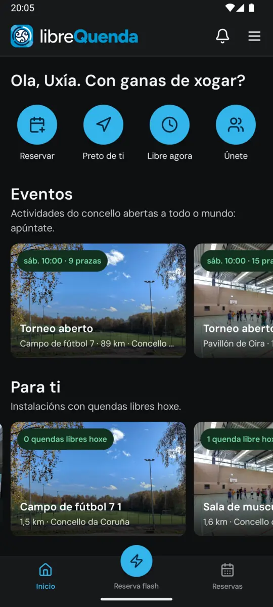
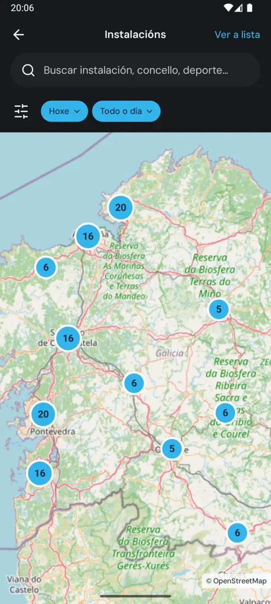
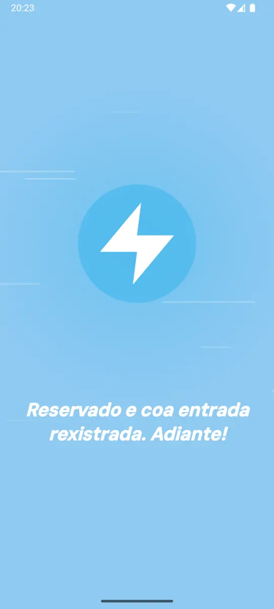

# Wiki de LibreQuenda

LibreQuenda é a reserva de instalacións deportivas municipais dos concellos galegos: software libre, sen depender dun provedor e pensado para quen reserva e para quen xestiona.

Esta wiki ensina o que se pode facer, pantalla a pantalla, segundo quen usa a aplicación:

| | Quen | Onde | Que fai |
|---|---|---|---|
| 🏃 | [**Veciñanza**](vecinanza.md) | App Android e web | Atopa onde xogar, reserva, entra na instalación sen chaves, valora, avisa de problemas e responde ás enquisas do concello |
| 🏛️ | [**Concello**](concello.md) | Web, en `/<concello>/admin` | Dá de alta as instalacións, os horarios e as normas, verifica a veciñanza, organiza eventos, publica comunicados e enquisas e mide o uso |
| 🛠️ | [**Superadministración**](superadmin.md) | Web, en `/admin` | Crea os concellos, mantén o catálogo de etiquetas e a imaxe da plataforma, e revisa o rexistro |

  
  
  

## Antes de empezar

- As capturas son dunha instalación local de proba co concello da Coruña e datos inventados: as persoas, as reservas e as valoracións non son reais.
- A app Android é só para a veciñanza; o concello e a superadministración traballan na web. Cando unha acción do concello chega á veciñanza (un aviso, un correo), a captura da app vai xunto á do concello.
- As capturas están en [`docs/screenshots`](../screenshots), en WebP, por rol e por función.
- A lista completa de funcións e o seu estado está en [`features.md`](../../features.md).
