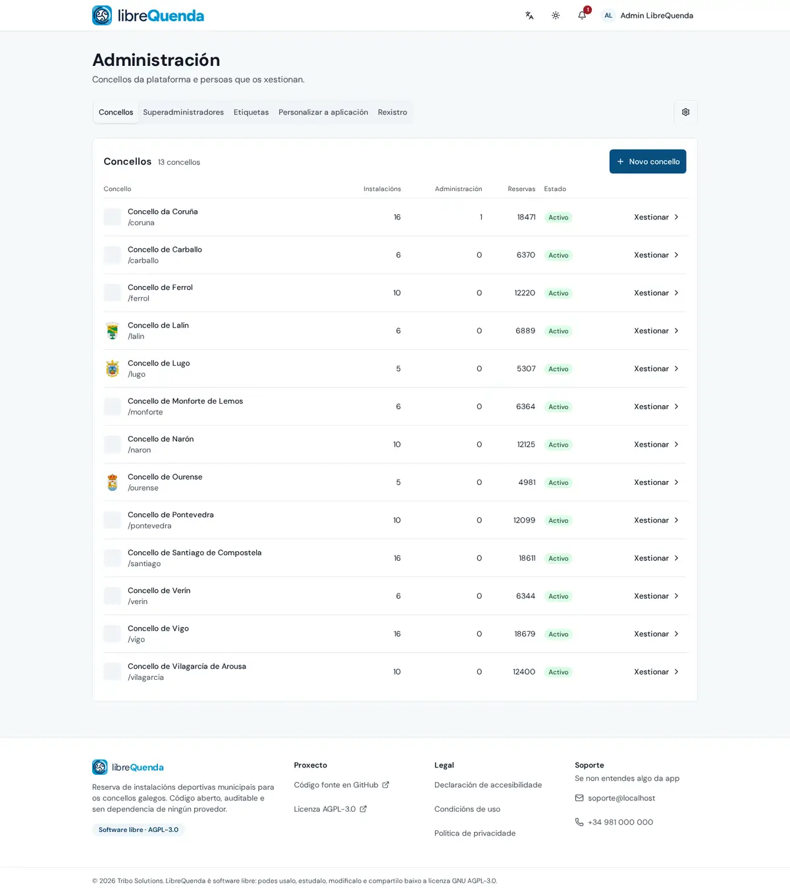
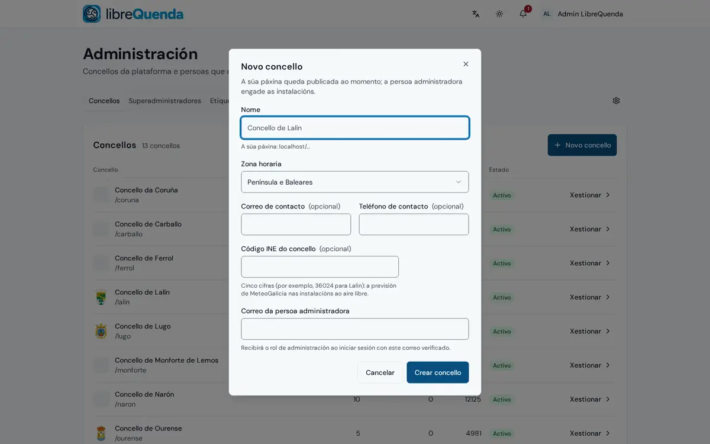
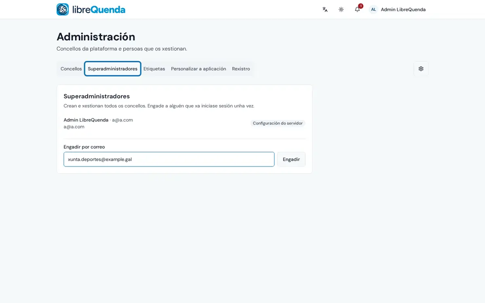
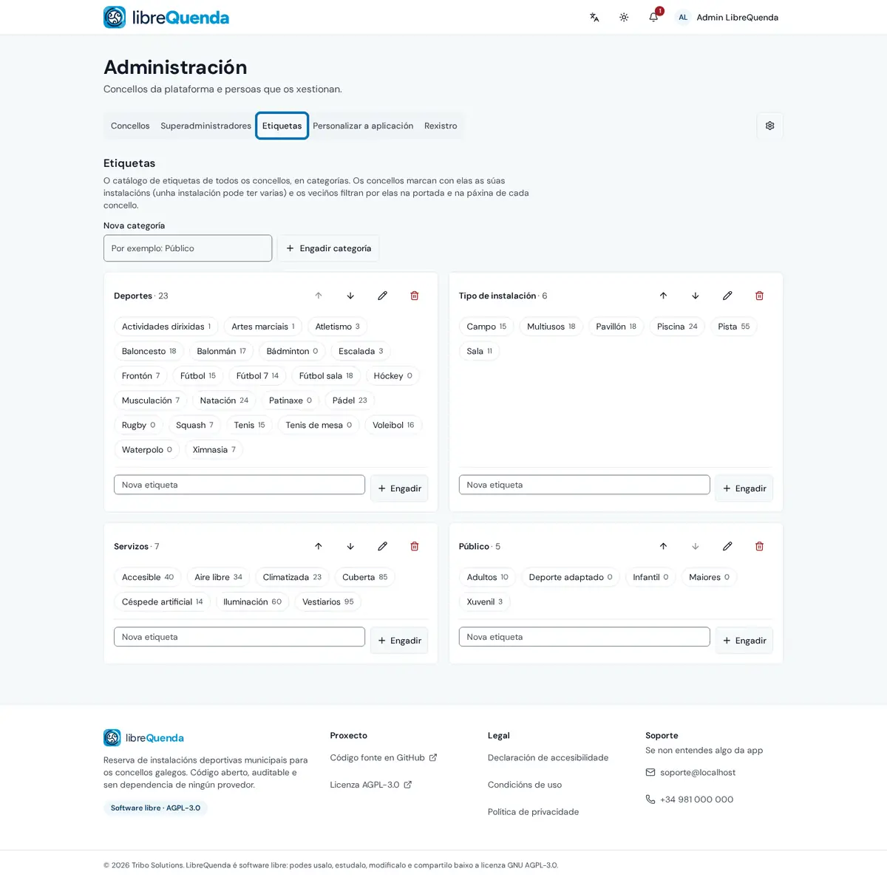
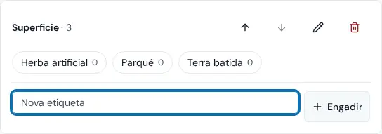
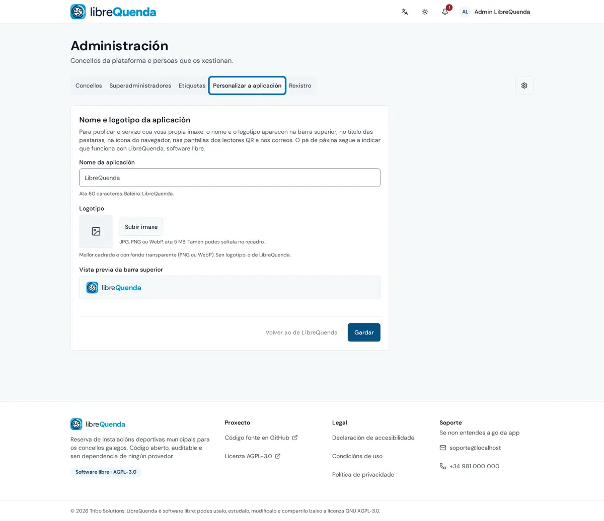
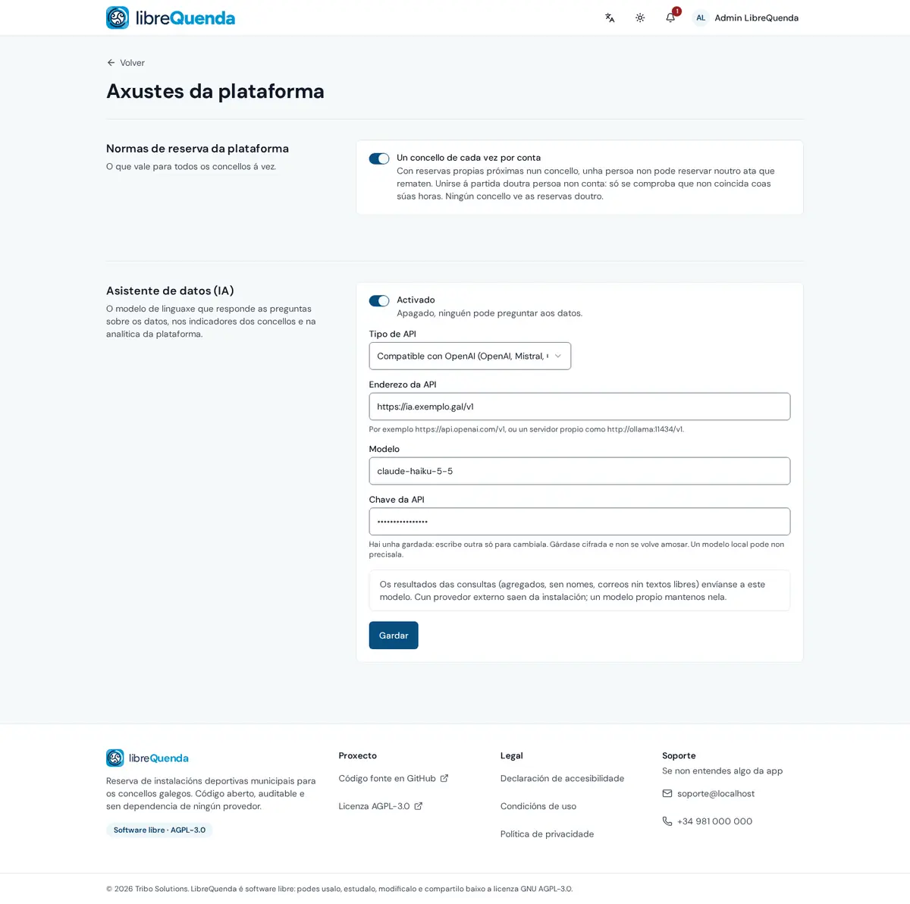
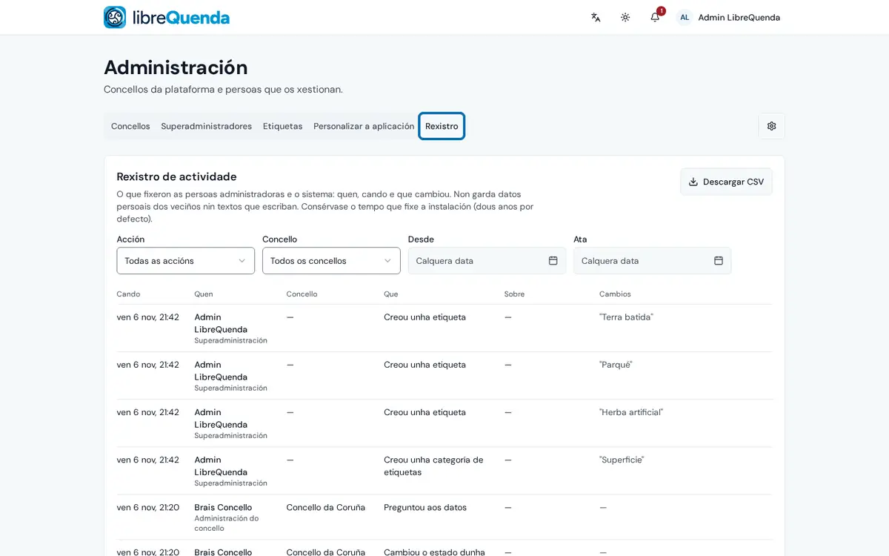

# 🛠️ Superadministración

O que fan as persoas superadministradoras da plataforma desde a web (`/admin`): crear os concellos e as súas persoas administradoras, manter o catálogo de etiquetas que comparten todos, a imaxe da instalación e as normas comúns, e revisar o rexistro de todo.

[← Volver á wiki](README.md) · [Veciñanza](vecinanza.md) · [Concello](concello.md)

**Índice:** [Concellos](#concellos) · [Superadministradores](#superadministradores) · [Etiquetas](#etiquetas) · [Personalizar a aplicación](#personalizar-a-aplicación) · [Axustes da plataforma](#axustes-da-plataforma) · [Rexistro](#rexistro)

---

## Concellos

Todos os concellos da plataforma, coas súas instalacións, persoas administradoras e reservas. Ao crear un, a súa páxina queda publicada e a persoa administradora recibe o rol ao iniciar sesión co correo verificado. «Xestionar» entra na administración dese concello.

## Superadministradores

Quen pode crear e xestionar todos os concellos. Engádese a alguén polo correo, unha vez que xa iniciou sesión.

## Etiquetas

Un catálogo de etiquetas para todos os concellos, en categorías (deportes, tipo de instalación, servizos, público). Os concellos marcan con elas as súas instalacións e a veciñanza filtra por elas. As categorías ordénanse, renoméanse e bórranse; ao lado de cada etiqueta, cantas instalacións a usan.

| Unha categoría nova coas súas etiquetas |
|:-:|
|  |

## Personalizar a aplicación

Para publicar o servizo coa imaxe propia: o nome e o logotipo aparecen na barra superior, no título das pestanas, na icona do navegador, nas pantallas dos lectores QR e nos correos, tamén nas de inicio de sesión.

## Axustes da plataforma

As normas que valen para todos os concellos (por exemplo, reservar nun só concello de cada vez) e o asistente de datos: o modelo de linguaxe que responde no «Fala cos datos» de cada concello. A chave gárdase cifrada e non se volve amosar.

## Rexistro

O rexistro de actividade de toda a plataforma: os cambios de todos os concellos e da superadministración, quen os fixo e cando. Só engade, non se edita; consérvase o tempo que fixe a instalación e descárgase en CSV.

